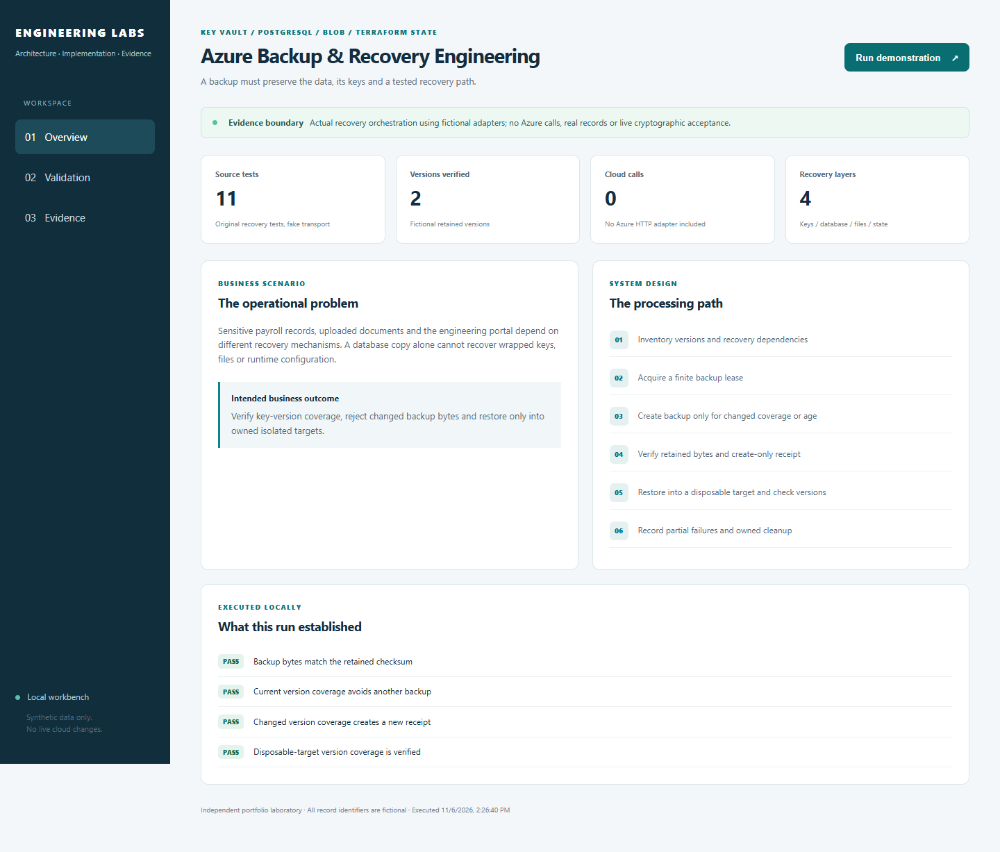
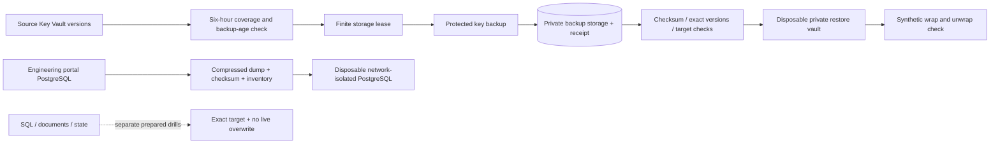
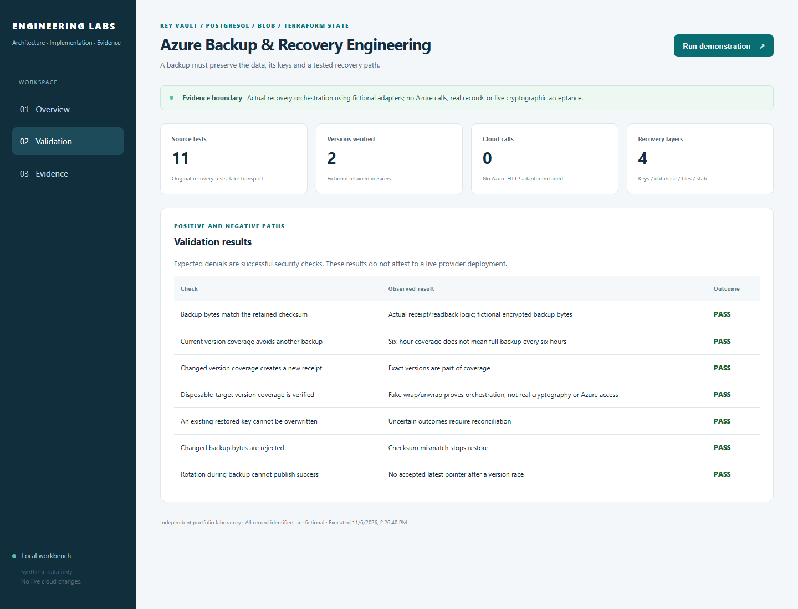

# Azure Backup & Recovery Engineering

**Recover the records, files, keys and settings the application needs to work.**

[The problem](#the-business-problem) · [The solution](#the-solution) · [What was built](#what-was-built) · [Proof it works](#proof-it-works) · [Commands](docs/COMMANDS.md)



## The Business Problem

The platform stores information in several services. Restoring a database is not enough if uploaded files, encryption keys or application settings are missing. Recovery tests must also avoid changing the live system.

## The Solution

Back up each required part, record how the parts fit together, and test recovery in a separate temporary environment. Check both the restored information and the access needed to use it. Keep failed checks visible rather than treating a saved backup file as proof of recovery.

**Business outcome:** Reduce uncertainty during recovery and identify missing files, keys, permissions or settings before they cause a longer outage.

### Actual implementation

This project uses the real platform's key-coordination of the backup steps and eleven original recovery tests, plus its PostgreSQL backup/inventory/restore helpers. Identifying configuration is replaced with examples; no private source history, employee information, backup bytes or credentials are published. The default key transport is an temporary test example held in memory and the code that connects to the cloud service over HTTP is omitted.

Historical platform records describe a private key restore with test-only wrap/unwrap verification, a recovered engineering portal, and later ordinary scheduled backup/coverage observations. SQL, document and Terraform-state drills prepared afterward are distinguished from those accepted tests. [Acceptance matrix](docs/ACCEPTANCE.md) · [Source map](docs/SOURCE-MAP.md).

## Architecture



## What Was Built

| Component | Purpose | Implementation |
| --- | --- | --- |
| Actual key-coordination of the backup steps | Inventory versions, create/read back backup, retain receipt and reconcile uncertain writes | [Source](reference/payroll_key_recovery.py) |
| Original recovery tests | Test rotation races, lost responses, target boundaries, checksum failures and partial coverage | [Tests](reference/test_payroll_key_recovery.py) |
| Finite lease | Coordinate overlapping checks and fail when lease ownership is lost | [Lease implementation](reference/payroll_key_recovery.py) |
| Actual PostgreSQL helpers | Dump plugin databases without role password hashes; verify an restore into a separate test environment | [Scripts](scripts/) |
| Storage and limited backup access | Keyless storage, versions, retention, container scope and opt-in exact-key metadata/backup role | [Terraform](infra/) |
| Recovery workbench | Run the extracted key orchestration with fictional adapters and show rejection cases | [Demo](lab/domain.py) |

## Proof It Works

**Current local checks:** 11 original source tests + 11 portable/public tests · 7 demo assertions · 3 Terraform mock plans. All passed; no cloud operation.

### 1. Original key-recovery tests

```bash
python -B -m unittest discover -s reference -v
```

**Look for:** eleven original tests; rotation during backup cannot publish success, old/current coverage is checked, changed bytes fail and an existing restored key is not overwritten. Fake HTTP and wrap/unwrap responses test orchestration; they do not establish real cryptography or Azure access.

### 2. Runnable recovery path and separate database checks

```bash
python -B -m unittest discover -s tests -v
python -B -m lab demo
```

**Look for:** seven key-orchestration assertions and the portable database recovery guards. The database demo is SQLite, not Azure SQL PITR or a PostgreSQL cluster restore.

### 3. Scoped infrastructure defaults

```bash
terraform -chdir=infra init -backend=false -input=false
terraform -chdir=infra validate
terraform -chdir=infra test
```

**Look for:** default-Off VM/key grants, private versioned storage and a backup-only key role that does not grant unwrap/rotation/deletion. Mock plans create no cloud resources and do not prove private connectivity.

### 4. Visible evidence



The screenshots show this local program, not fabricated Azure Portal results. [Dated validation](docs/VALIDATION.md) records what was executed. [Nonproduction capture plan](docs/SCREENSHOT-PLAN.md) identifies future portal/terminal evidence without starting services for screenshots.

## Run It Locally

Python 3.12 is sufficient for the standard-library demo. From a clone:

```bash
python -m venv .venv
source .venv/bin/activate
python -m pip install -r requirements.txt
python -B -m unittest discover -s reference -v
python -B -m unittest discover -s tests -v
python -B -m lab serve --port 8011
```

PowerShell: invoke `.venv\Scripts\python.exe` directly instead of activating. Open [the local workbench](http://127.0.0.1:8011), run the demonstration, then inspect Validation and Evidence. Stop with Ctrl+C. No Azure login, real data or paid call is required.

## Terraform Infrastructure

Related [Terraform](infra/README.md) parameterizes the private backup-store/operational-log pattern, optional recovery compute and the actual source key's metadata/backup-only permission boundary. Private endpoints, DNS, schedules, runtime secret handling and live identity grants are separate commissioning work. This project is not a one-command deployment of the production recovery system.

## Security Practices

- Data and keys have different custodians and restore dependencies; preserve exact version metadata.
- Use isolated targets and do not attach restored data to a running sender, provider worker or public API.
- A clean-file verdict tied to original bytes cannot be reused for changed restored bytes.
- Key backup/restore roles differ from runtime wrap/unwrap and key rotation. The default example grants none.
- Protected key backups have subscription/geography constraints. A restored key in a new vault has a new URI and requires a tested application recovery mapping.
- Checksums depend on trusted receipts; a hash stored beside attacker-controlled data is not independent authenticity.

## Scaling and Tradeoffs

The live key coverage job checks every six hours UTC and backs up for changed versions/enable flags or a backup age of seven days. A check frequency is not a guarantee of record RPO. Measure actual recovery time by layer and business impact. [Scaling, costs and tradeoffs](docs/SCALING.md).

## Project Guides

| Guide | Purpose |
| --- | --- |
| [Architecture](docs/ARCHITECTURE.md) | Recovery layers, permissions and dependency chain |
| [Implementation walkthrough](docs/WALKTHROUGH.md) | Follow actual backup/restore code |
| [Commands](docs/COMMANDS.md) | Prerequisites, expected results and source tests |
| [Source map](docs/SOURCE-MAP.md) | Extracted files and deliberate adaptations |
| [Acceptance matrix](docs/ACCEPTANCE.md) | Completed historical work versus prepared drills |
| [Operating guide](docs/OPERATIONS.md) | Diagnose failed backup, partial restore and missing keys |
| [Validation](docs/VALIDATION.md) | Dated local checks and their limits |
| [Capture plan](docs/SCREENSHOT-PLAN.md) | Future nonproduction Portal/terminal evidence |
| [Scaling](docs/SCALING.md) | RPO/RTO, volume, retention and recovery costs |

## Cost and Cleanup

The default run uses fictional in-memory/local fixtures. No provider operation or cloud deployment occurs. Terraform is opt-in source; a real apply can create billable resources. Keep backups, keys, state and private receipts out of this repository. Public validation is manual-only to conserve Actions minutes.
