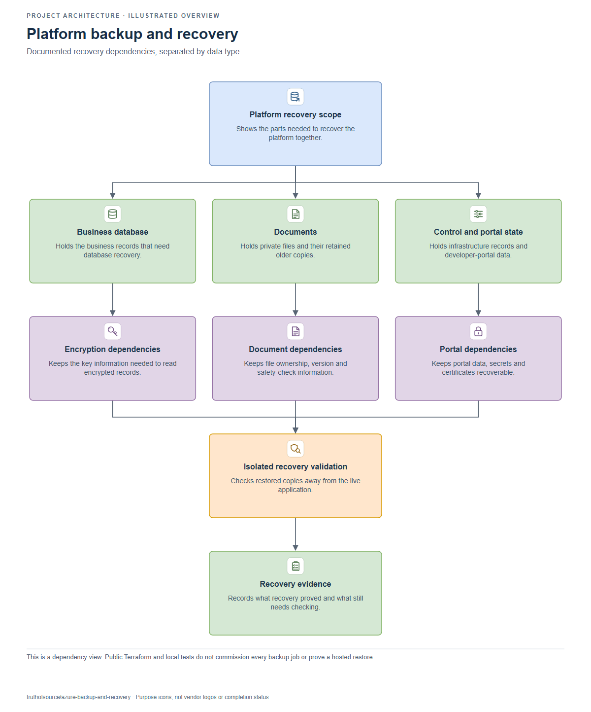

# Azure Backup & Recovery Engineering

[](docs/diagrams/architecture.svg)

[View SVG](docs/diagrams/architecture.svg) · [Download PNG](docs/diagrams/architecture.png) · [Edit in draw.io](docs/diagrams/architecture.drawio)

**Recover the records, files, keys and settings the application needs to work.**

[The problem](#the-business-problem) · [The solution](#the-solution) · [What was built](#what-was-built) · [Proof it works](#proof-it-works) · [Commands](docs/COMMANDS.md) · [Step by step](#step-by-step)

## The Business Problem

The platform's working records depend on several services: database rows, uploaded documents, encryption keys, application configuration and supporting engineering systems. A failure or accidental change can affect one part while leaving the others available. Recovering those parts independently can still produce a system that cannot perform its normal work.

A backup file alone leaves important questions open: can it be read, are the required key versions available, do the restored records match their files and can the service identity reach them? Testing recovery directly against production can put the remaining good data at risk. Temporary recovery resources also need a clear cleanup point.

The business need was a dependency-aware recovery plan with isolated tests and recorded checks, so the team knows which recovery paths are proven and which still need preparation.

## The Solution

Back up each required part, record how the parts fit together, and test recovery in a separate temporary environment. Check both the restored information and the access needed to use it. Keep failed checks visible rather than treating a saved backup file as proof of recovery.

**Business outcome:** Reduce uncertainty during recovery and identify missing files, keys, permissions or settings before they cause a longer outage.

### Actual implementation

This project uses the real platform's key-backup process and eleven original recovery tests, plus its PostgreSQL backup/inventory/restore helpers. Identifying configuration is replaced with examples; no private source history, employee information, backup bytes or credentials are published. The default key transport is a temporary test example held in memory and the code that connects to the cloud service over HTTP is omitted.

Historical platform records describe a private key restore with test-only wrap/unwrap verification, a recovered engineering portal, and later ordinary scheduled backup/coverage observations. SQL, document and Terraform-state drills prepared afterward are distinguished from those accepted tests. [Acceptance matrix](docs/ACCEPTANCE.md) · [Source map](docs/SOURCE-MAP.md).

## Tools Used and What They Do

| Tool or service | What it does | Where it fits |
| --- | --- | --- |
| Azure Key Vault | Keep the versioned keys whose protected backups support recovery. | Actual platform dependency; key metadata and backup authority are scoped. |
| Azure Blob Storage | Retain protected backup objects and supporting evidence. | Actual backup store; no real backup bytes are included here. |
| PostgreSQL utilities, including pg_dumpall | Create and restore the engineering portal’s database backup. | Actual helper scripts; separate from Azure SQL recovery. |
| AzCopy, gzip and SHA-256 utilities | Transfer backups, compress dumps and compare exact file fingerprints. | Actual operating utilities; managed-identity upload needs its own commissioned access. |
| Bash and Docker | Run the selected Linux database backup/restore helper path. | Operating/test prerequisites; the demo does not start a live database. |
| Python and SQLite | Exercise recovery rules and an isolated fictional database. | Public local model, not Azure SQL PITR or a PostgreSQL cluster restore. |
| Terraform | Describe selected storage/logging and optional recovery resources. | Reference configuration; restore drills have separate acceptance status. |

The source key-backup coordinator is also Python. Its local transport uses test responses; passing those tests does not establish real key-service access or cryptographic recovery.

## Step by Step

Your own Azure VM backup and an isolated restore, verified using a file you created before the backup.

[Open the standalone build guide](docs/BUILD-YOUR-OWN.md) or follow the same complete instructions below.

Start with a new folder, your own files and your own accounts. The numbered steps below describe the build; no portfolio repository checkout is required. The existing implementation/evidence elsewhere in this repository is a separate reference, not a claim that your new build has already passed.

### Prerequisites

An isolated Azure VM you may back up, Azure Backup permissions, a separate restore VNet/subnet and a cost estimate for the vault, backup storage and temporary restored compute.

Use Bash on Linux/macOS/WSL for Bash blocks and PowerShell for PowerShell blocks. Select the tool versions supported by the official sources below, record the versions you actually install and retain generated dependency locks. Cloud resources, scanner downloads, logs and external AI calls can create costs; review the stated scope before enabling them.

### Create your project folder

Choose a new folder name. These first commands create a blank project; an optional `git init` gives it its own history. Create parent directories in your editor when a later step introduces a nested file.

```bash
mkdir my-azure-backup-and-recovery
cd my-azure-backup-and-recovery
git init
```

Create `.gitignore` before saving credentials or build outputs:

```gitignore
.venv/
node_modules/
.env
.env.*
local.settings.json
credentials.json
token.json
*.pem
*.key
*.tfstate*
*.tfplan
.terraform/
private*/
captures/
backups/
batch.json
reports/
out/
app-config.local.yaml
```

The source/file snippets are a starting implementation you type or paste into the named files. Replace `YOUR_*`, names, regions and addresses only with values from your own lab; do not place real client/employee records in a test project. Keep your terminal in this project root unless a step explicitly changes directory.

Before a first commit, set your own repository-local author with `git config user.name "YOUR_NAME"` and `git config user.email "YOUR_PUBLIC_COMMIT_EMAIL"`. Review `git status --short` and the staged diff before publishing; ignored local files are not a substitute for reviewing what you upload.

### Step 1 — Prepare a recoverable workload

**Where:** Your own Linux VM through an approved administration path.

Write a unique harmless file on a persistent OS/data disk and record its hash, OS version and application dependencies. Do not use a temporary disk or /tmp for a backup marker.

```bash
sudo mkdir -p /var/lib/my-recovery-lab
printf 'My recovery marker\n' | sudo tee /var/lib/my-recovery-lab/marker.txt >/dev/null
sha256sum /var/lib/my-recovery-lab/marker.txt
```

**Check before continuing:** You have a file/hash pair that can be checked after restoring.

### Step 2 — Create the vault and protection policy

**Where:** Azure Portal → Recovery Services vaults → Create.

Create a vault in the appropriate region for your VM and set its redundancy, security and retention choices. Select Backup → Azure → Virtual machine, choose a policy and add only your lab VM.

**Check before continuing:** The vault lists the VM as a protected item under your chosen policy.

### Step 3 — Run and verify a backup

**Where:** Vault → Backup items → Azure Virtual Machine.

Start Backup now and follow the job to its terminal result. Record the actual recovery point and any application-consistency limitations instead of treating submission as completion.

**Check before continuing:** A completed backup job and selectable recovery point exist.

### Step 4 — Restore separately

**Where:** Protected VM → Restore VM.

Select that recovery point and Create new virtual machine into the isolated restore network. Use a new name, avoid attaching it to the source application, and account for the staging storage/identity prerequisites shown by the restore wizard.

**Check before continuing:** A distinct restored VM exists without replacing the original.

### Step 5 — Prove recovery

**Where:** Your approved administration path on the restored VM.

Verify its resource/VM identity before reading the marker and comparing the hash. Check application start, storage mounts and required access separately; a successful boot does not prove the application is usable.

**Check before continuing:** The restored marker matches and every additional readiness check has an observed result.

### Step 6 — Close the rehearsal

**Where:** Your evidence record and vault.

Record backup/restore timing, RPO/RTO observations and missing dependencies. Remove only the temporary restore resources, then deliberately choose how the lab protected item and retained backup data should be handled; never disable a shared vault lock or purge recovery data as routine cleanup.

**Check before continuing:** The run is documented and all temporary compute/storage costs have an owner.

### Verification and your own screenshots

| Evidence | What to record | Your result |
| --- | --- | --- |
| New build | Your own files/resource settings and tool versions | Not yet recorded |
| Working path | The actual successful request, configuration or recovery result | Not yet recorded |
| Failure boundary | A meaningful denied, malformed, stale or failed case | Not yet recorded |
| Recovery / cleanup | What you restored or removed and what remains billed | Not yet recorded |

Capture your own architecture/configuration, one working result and one failure/recovery result. Keep tokens, credentials, personal records and private identifiers out of public screenshots. The architecture diagram explains the design; record your own results rather than treating it as execution evidence.

### Troubleshooting order

1. Confirm the named file, working directory and selected tool/interpreter.
2. Check the exact input and resource/account selected for the failing step.
3. Separate identity permission, network/DNS reachability and application validation.
4. Keep the actual error and reconcile an unknown write outcome before repeating it; do not widen access or repeat paid operations blindly.

The numbered steps describe a build procedure. Local syntax checks, an accepted API request, a completed hosted operation and a human verification are different evidence levels; fill in the verification table with what you actually observed.

### Official implementation references

- [learn.microsoft.com — backup-azure-vms-first-look-arm](https://learn.microsoft.com/en-us/azure/backup/backup-azure-vms-first-look-arm)
- [learn.microsoft.com — backup-azure-arm-restore-vms](https://learn.microsoft.com/en-us/azure/backup/backup-azure-arm-restore-vms)

The walkthrough layout follows the prerequisites → creation/configuration → test → verification → troubleshooting → cleanup pattern of the [Splunk project reference](https://github.com/davidharris6/splunk-siem-log-analysis). Its Splunk-specific settings are not copied into unrelated projects.

<details>
<summary>Reference: how the existing platform implementation operates</summary>

A short walkthrough of the process, with technical instructions and evidence limits in the sections below.

1. **Identify what must be recovered** — List the databases, files, encryption keys and settings the application needs. Record their owners and how those parts fit together.

2. **Save and check the backups (Key and database backup helpers)** — The included helpers save selected backups with records of their contents and file fingerprints. They check the saved copies rather than assuming an upload succeeded.

3. **Prepare a separate restore target** — Use an isolated destination so a recovery test cannot overwrite the live system. The case study distinguishes completed recovery evidence from later rehearsals that remained prepared.

4. **Verify usability and close the test** — Compare recovered contents and check the access needed to use them. Record the result and remove or pause temporary resources when the test is complete.

</details>

## Architecture

[View the illustrated project overview](docs/diagrams/architecture.svg).

## What Was Built

| Component | Purpose | Implementation |
| --- | --- | --- |
| Key-backup process | List key versions, save and recheck backups, keep a result record and investigate unclear saves | [Source](reference/payroll_key_recovery.py) |
| Original recovery tests | Test rotation races, lost responses, target boundaries, checksum failures and partial coverage | [Tests](reference/test_payroll_key_recovery.py) |
| Temporary lock | Prevent checks from competing and stop if this process loses its temporary lock | [Lease implementation](reference/payroll_key_recovery.py) |
| Actual PostgreSQL helpers | Save the portal databases without role password hashes, then test recovery separately | [Scripts](scripts/) |
| Storage and limited backup access | Keyless storage, versions, retention, container scope and opt-in exact-key metadata/backup role | [Terraform](infra/) |
| Recovery workbench | Run the real key-backup rules with test connections and show which cases are rejected | [Demo](lab/domain.py) |

## Recovery Evidence in Sentinel

Selected existing recovery and storage observations now reach the hub security workspace through a separate metadata-only collector. This adds investigation context; it does not turn a backup receipt into proof of restoration or activate new operations alerts.

[Evidence, boundaries and the companion Sentinel implementation](docs/SECURITY-OBSERVABILITY.md) explains what was verified. The local demonstration below retains its fictional scope.

## Proof It Works

**Current local checks:** 11 original source tests + 11 portable/public tests · 7 demo assertions · 3 Terraform mock plans. All passed; no cloud operation.

### 1. Original key-recovery tests

```bash
python -B -m unittest discover -s reference -v
```

**Look for:** eleven original tests; rotation during backup cannot publish success, old/current coverage is checked, changed bytes fail and an existing restored key is not overwritten. Fake HTTP and wrap/unwrap responses test orchestration; they do not establish real cryptography or Azure access.

### 2. Runnable recovery path and separate database checks

```bash
python -B -m unittest discover -s tests -v
python -B -m lab demo
```

**Look for:** seven key-orchestration assertions and the portable database recovery guards. The database demo is SQLite, not Azure SQL PITR or a PostgreSQL cluster restore.

### 3. Scoped infrastructure defaults

```bash
terraform -chdir=infra init -backend=false -input=false
terraform -chdir=infra validate
terraform -chdir=infra test
```

**Look for:** default-Off VM/key grants, private versioned storage and a backup-only key role that does not grant unwrap/rotation/deletion. Mock plans create no cloud resources and do not prove private connectivity.

### 4. Visible evidence

The local program remains available to run; proper Azure and application screenshots are deferred. [Dated validation](docs/VALIDATION.md) records what was executed. [Nonproduction capture plan](docs/SCREENSHOT-PLAN.md) identifies future portal/terminal evidence without starting services for screenshots.

## Run It Locally

Python 3.12 is sufficient for the standard-library demo. From a clone:

```bash
python -m venv .venv
source .venv/bin/activate
python -m pip install -r requirements.txt
python -B -m unittest discover -s reference -v
python -B -m unittest discover -s tests -v
python -B -m lab serve --port 8011
```

PowerShell: invoke `.venv\Scripts\python.exe` directly instead of activating. Open [the local workbench](http://127.0.0.1:8011), run the demonstration, then inspect Validation and Evidence. Stop with Ctrl+C. No Azure login, real data or paid call is required.

## Terraform Infrastructure

Related [Terraform](infra/README.md) parameterizes the private backup-store/operational-log pattern, optional recovery compute and the actual source key's metadata/backup-only permission boundary. Private endpoints, DNS, schedules, runtime secret handling and live identity grants are separate commissioning work. This project is not a one-command deployment of the production recovery system.

## Security Practices

- Data and keys have different custodians and restore dependencies; preserve exact version metadata.
- Use isolated targets and do not attach restored data to a running sender, provider worker or public API.
- A clean-file verdict tied to original bytes cannot be reused for changed restored bytes.
- Key backup/restore roles differ from runtime wrap/unwrap and key rotation. The default example grants none.
- Protected key backups have subscription/geography constraints. A restored key in a new vault has a new URI and requires a tested application recovery mapping.
- Checksums depend on trusted receipts; a hash stored beside attacker-controlled data is not independent authenticity.

## Scaling and Tradeoffs

The live key coverage job checks every six hours UTC and backs up for changed versions/enable flags or a backup age of seven days. A check frequency is not a guarantee of record RPO. Measure actual recovery time by layer and business impact. [Scaling, costs and tradeoffs](docs/SCALING.md).

## Troubleshooting Lessons

A zero exit status did not prove a fresh backup existed. Recovery also had to wait for the final initialized database service, rather than an earlier temporary listener. [Read the incident, evidence and verification](docs/LESSONS-LEARNED.md).

## Project Guides

| Guide | Purpose |
| --- | --- |
| [Architecture](docs/ARCHITECTURE.md) | Recovery layers, permissions and dependency chain |
| [Implementation walkthrough](docs/WALKTHROUGH.md) | Follow actual backup/restore code |
| [Commands](docs/COMMANDS.md) | Prerequisites, expected results and source tests |
| [Source map](docs/SOURCE-MAP.md) | Extracted files and deliberate adaptations |
| [Acceptance matrix](docs/ACCEPTANCE.md) | Completed historical work versus prepared drills |
| [Operating guide](docs/OPERATIONS.md) | Diagnose failed backup, partial restore and missing keys |
| [Validation](docs/VALIDATION.md) | Dated local checks and their limits |
| [Capture plan](docs/SCREENSHOT-PLAN.md) | Future nonproduction Portal/terminal evidence |
| [Scaling](docs/SCALING.md) | RPO/RTO, volume, retention and recovery costs |

## Cost and Cleanup

The default run uses fictional in-memory/local fixtures. No provider operation or cloud deployment occurs. Terraform is opt-in source; a real apply can create billable resources. Keep backups, keys, state and private receipts out of this repository. Public validation is manual-only to conserve Actions minutes.

## Consolidated Examples

These related implementations are now maintained here:

- [platform-operations-and-recovery](examples/operational-recovery/README.md)

See [the consolidation guide](docs/CONSOLIDATION.md) for component scope, preserved tests and historical evidence.
